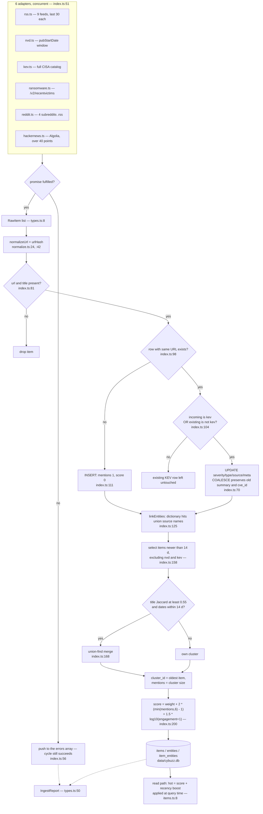

# CyBuzz — Engineering Document

> A cybersecurity news aggregator that ranks what the industry is talking about:
> attacks, CVEs, breaches, ransomware victims and community signal, consolidated
> from 15+ public sources into one buzz-ranked page.
>
> Stack: Next.js 14 (App Router) · TypeScript · better-sqlite3 · Tailwind CSS ·
> zero external services. Local-first by design.

---

## 1. Product shape

CyBuzz answers one question: **what is the security industry talking about right now?**

| Surface | What it shows | Where it reads |
|---|---|---|
| `/` The Buzz | buzz-ranked card grid, breaking ticker, type filters | `getFeed()` — score + recency |
| `/actions` | **Action Center**: fresh KEV with CISA deadlines + required actions, trending exploitation, ransomware hot streak | `getFreshKev()`, `getTrendingExploited()`, `getRansomwareTrends()` |
| `/mystack` | **Stack Watchlist**: personal alert feed from chosen vendors/products (localStorage) | `getItemsByEntities()` via API |
| `/cve` | CISA KEV spotlight (actively exploited) + recent CVE list | `getCves()` |
| `/attacks` | attacks, breaches, ransomware incidents (14 d) | `getAttacks()` |
| `/companies` + `/companies/[slug]` | most-mentioned orgs → per-entity history | `getTopEntities()`, `getEntity()` |
| `/search?q=` | keyword / CVE-ID / company lookup | `searchItems()` |
| `/bookmarks` | saved stories | browser `localStorage` |
| `POST /api/ingest` | triggers one pipeline cycle | `runIngest()` |
| `GET /api/items` | JSON mirror of every view | query layer |

The "BuzzFeed" mechanic is **cross-source clustering**: when six outlets publish the
same story, the cluster's `mentions` count multiplies each member's buzz score, and
cards render `×6 sources`. Community signal (Hacker News points, Reddit) rides the
same pipeline as `discussion` items with an engagement term in the score.

## 2. Architecture at a glance

```
            ┌────────────────────────────────────────────────────────┐
            │                    one Next.js app                     │
            │                                                        │
 feeds ────►│  src/lib/ingest/*        src/lib/items.ts   src/app/*  │
 APIs ─────►│  ┌──────────────────┐    ┌─────────────┐   ┌─────────┐ │
            │  │ fetch → normalize│───►│ SQL views   │──►│ RSCs    │ │
            │  │ dedupe → upsert  │    │ (hot rank)  │   │ + API   │ │
            │  │ entities → cluster│   └─────────────┘   │ routes  │ │
            │  │ → score          │          │          └─────────┘ │
            │  └──────────────────┘          ▼                       │
            │                    better-sqlite3 (data/cybuzz.db)     │
            └────────────────────────────────────────────────────────┘
   CLI:  npm run ingest   (tsx scripts/ingest.ts)
   UI:   Refresh button → POST /api/ingest → router.refresh()
```

Three layers, one process: **ingest** (writes), **query** (reads), **UI** (server
components calling the query layer directly — no self-HTTP hop). The API routes
exist for the Refresh widget and future consumers, not for the pages.

## 3. Technology choices and rejected alternatives

| Choice | Why | What we rejected and why |
|---|---|---|
| **Next.js 14 App Router** (patched 14.2.35) | one codebase for pages + API + ingestion; RSCs read SQLite directly, zero client data layer | Separate scraper service + static frontend: two deployables for a single-user tool. *When to split:* if ingestion ever needs its own scaling or Python-only libs. |
| **SQLite via better-sqlite3** | synchronous, embedded, zero ops; WAL handles the one writer + many readers pattern perfectly; the whole DB is a file you can delete | Postgres/Supabase: network hop + credentials + cost for a local-first v1. *Rejected for v1, planned for deploy.* Drizzle ORM: an abstraction we don't need yet — schema is 4 tables; raw SQL is clearer. When we deploy to Postgres, drizzle-kit becomes the migration tool. |
| **RSS/Atom + public JSON APIs** | every major outlet publishes a stable, machine-readable feed; free, ToS-clean, resilient | **HTML scraping** (Playwright/BeautifulSoup): brittle, ToS-hostile, unnecessary. **NewsAPI/GNews aggregators**: paid or watermarked, and they just re-host the same RSS. **Instagram**: ToS forbids scraping, Graph API needs business-account approval — dropped. |
| **Cron-less pull** (`npm run ingest` / Refresh button) | honest for local-first; no scheduler to babysit | `setInterval` in the server process: silently dies with dev-server restarts, hides failures. Deploy story: real cron (Fly.io machines / Vercel cron) calling `POST /api/ingest`. |
| **Dictionary entity matching** (`src/lib/entities.ts`) | deterministic, zero cost, covers ~90% of headlines (big vendors + breach regulars) | LLM extraction in v1: latency, cost, nondeterminism before the dictionary floor exists. Kept as the v2 upgrade. |
| **Tailwind + CSS variables** | theme is one `:root` block (`src/app/globals.css:11-24`) — swap it and the whole app re-skins | shadcn/UI: component lock-in for a design this small. Flowbite pasted markup (the previous `src/app/components/`): dead links, wrong logo, `class=` instead of `className=` — deleted. |
| **`localStorage` bookmarks** | no accounts in v1 (explicit scope call); right shape to swap for server-side later | Auth.js/Supabase auth from day one: blocked the whole v1 demo behind login. |
| **No build step beyond Next itself** | `tsx` runs the ingest CLI directly against `src/lib` — the pipeline is plain TypeScript, portable to any runtime | Python ingestion sidecar: second language, second dependency manager, for nothing Node can't do. |

## 4. Data sources

Every source, its protocol, and the exact drift lessons we hit **during the build
of this feature** (source APIs changed under us three times — see §11).

| Source | Protocol / endpoint | Auth | Rate limit | Feeds |
|---|---|---|---|---|
| The Hacker News | RSS `feeds.feedburner.com/TheHackersNews` | — | polite | news, CVEs |
| BleepingComputer | RSS `bleepingcomputer.com/feed/` | — | polite | ransomware, breaches |
| Krebs on Security | RSS `krebsonsecurity.com/feed/` | — | polite | deep breach reporting |
| SecurityWeek | RSS `securityweek.com/feed/` | — | polite | news |
| Dark Reading | RSS `darkreading.com/rss.xml` | — | polite | enterprise angle |
| The Record | RSS `therecord.media/feed` | — | polite | policy + scoops |
| CyberScoop | RSS `cyberscoop.com/feed/` | — | polite | gov/policy |
| SANS ISC | RSS `isc.sans.edu/rssfeed.xml` | — | polite | diary |
| Cisco Talos | Atom `blog.talosintelligence.com/feeds/posts/default` | — | polite | threat research |
| NVD | REST `services.nvd.nist.gov/rest/json/cves/2.0?pubStartDate=…&pubEndDate=…` | optional key | 5 req/30 s no-key | all new CVEs |
| CISA KEV | JSON `cisa.gov/…/known_exploited_vulnerabilities.json` | — | — | actively-exploited CVEs |
| ransomware.live | REST `api.ransomware.live/v2/recentvictims` | — | 1 req/min | named victims |
| Reddit ×4 | Atom `reddit.com/r/{netsec,cybersecurity,blueteamsec,InfoSec}/top.rss` | — | polite | community |
| Hacker News | REST `hn.algolia.com/api/v1/search?query=…&tags=story` | — | generous | community + points |

**Drift lessons (all discovered live, all fixed in-repo):**
1. **NVD** removed the `startDate` parameter — any request using it now returns
   `404` with an empty body. Current names: `pubStartDate`/`pubEndDate` (must be
   passed as a pair, format `yyyy-MM-ddTHH:mm:ss.SSS`, **no `Z` suffix**).
   `src/lib/ingest/nvd.ts:30`
2. **Reddit** killed anonymous `*.json` access (serves HTML/302). The Atom
   `*.rss` endpoint still works; the cost is no upvote counts, so Reddit items
   rank on freshness + clustering only. `src/lib/ingest/reddit.ts:1`
3. **ransomware.live** deprecated v1: `/recentincidents` 302-redirects to docs.
   v2 is free, unauthenticated, 1 req/min, flat route names
   (`/v2/recentvictims`). ~10% of v2 listings are redacted placeholders
   (`Company #137`, `… (Not Found)`, `page-<hash>`) — filtered at the adapter
   boundary (`src/lib/ingest/ransomware.ts:28`) because they pollute both the
   feed and the entity graph.

**Deliberately excluded:** X/Twitter (API v2 Basic is now paid-only), Instagram
(ToS + business-API friction), Telegram (no public read API), NewsAPI-family
aggregators (paywall for the free tier we'd need).

## 5. The ingestion pipeline

One cycle = `runIngest()` (`src/lib/ingest/index.ts:36`). Every adapter is
isolated by `Promise.allSettled`, so a dead or rate-limited source costs you
only its own slice of the cycle — it returns a report instead of throwing:

```
fetch (6 adapters, parallel)          ~2,000 raw items
  └► normalize                        URL canonicalization + sha1 hash
       └► upsert (single tx)         dedupe by URL; KEV upgrades NVD rows
            └► entity tagging        dictionary ∪ source-provided names
             └► cluster (14 d)    union-find over title Jaccard ≥ 0.55
                       └► score        weight + cluster bonus + engagement
```

### 5.0 Pipeline flowchart

The decision points the linear sketch above hides — the failure isolation at the
adapter boundary, the URL-dedupe branch, and the rank rule that lets KEV
overwrite an NVD row but never the reverse. Every node cites the code.



### 5.1 Adapters → `RawItem`

Each adapter's only contract is producing `RawItem[]`
(`src/lib/types.ts:9`): title, url, source, `sourceKind`, vertical `type`,
optional `severity`/`cveId`/`engagement`/`entityNames`. That single shape is
what makes six wildly different protocols (RSS, Atom, three REST APIs, a JSON
blob) merge into one stream.

```ts
// src/lib/ingest/kev.ts:24 — KEV marks every entry critical:
// "KEV inclusion means confirmed exploitation"
severity: "critical",
// and reuses the NVD detail URL as canonical id, which is what lets the
// upsert merge KEV onto a plain NVD row instead of duplicating it:
url: `https://nvd.nist.gov/vuln/detail/${v.cveID}`,
```

### 5.2 Normalization & dedupe

`normalizeUrl()` (`src/lib/ingest/normalize.ts:24`) strips tracking params
(`utm_*`, `fbclid`, `gclid`, `ref`), lowercases + de-`www.` the host, drops the
fragment, and trims the trailing slash. Two outlets linking to the same article
with different trackers collapse to one row. `UNIQUE(url)` is the hard
guarantee; `url_hash` (sha1) exists as a fast lookup column.

### 5.3 The upsert with a rank rule

```ts
// src/lib/ingest/index.ts:102 — inside one better-sqlite3 transaction:
if (existing) {
  // KEV outranks a plain NVD row on the same URL; never downgrade.
  if (row.sourceKind === "kev" && existing.source_kind !== "kev") {
    upgrade.run({ ...row, id: existing.id });
    linkEntities(existing.id, it);
    updated++;
  }
  continue;
}
```

The asymmetry is deliberate: KEV is a *verdict* (confirmed exploited), NVD is a
*record*. When both describe one CVE, the row keeps its id, gets `critical`
severity, and its source display flips to "CISA KEV" for the UI spotlight.

### 5.4 Entity tagging (the "affected companies" feature)

Two producers, one merge (`src/lib/ingest/index.ts:124`):
1. **Dictionary match** over title+summary — ~100 curated entities with
   aliases, word-boundary regexes, longest-term-first so
   "Change Healthcare" beats "Change" (`src/lib/entities.ts:145`).
2. **Source-provided names** — ransomware victims, KEV `vendorProject`/
   `product` — exact, not guessed.

Entities are upserted by slug and linked via `item_entities`, which powers the
`/companies` graph. Current live counts: **1,047 entities, ~4,000 links**.

### 5.5 Cross-source clustering

The trending mechanic. Over a rolling 14-day window (excluding NVD/KEV rows —
one CVE is one URL, already merged at upsert):

```ts
// src/lib/ingest/index.ts:152 — union-find over pairwise title similarity
const CLUSTER_THRESHOLD = 0.55;                      // index.ts:23
jaccard(titleTokens(a), titleTokens(b)) >= 0.55      // normalize.ts:53-69
```

`titleTokens()` lowercases, splits, drops stopwords ("the", "says",
"reported"…), keeps word sets. Union-find groups them; the **oldest item
becomes the cluster representative** (`cluster_id`), and every member gets
`mentions` = cluster size. Live check: 55 items currently show `×2+ sources`.

*Why pairwise and not embeddings:* ~300 non-CVE items per window → 45k
comparisons per cycle, sub-second, deterministic, and debuggable by reading
two titles. Embeddings would add an API dependency, cost, and nondeterminism
for marginal recall on short news titles. If the window grows 10×, bucket by
CVE-id/shared-token blocking first.

## 6. The ranking model

Stored buzz (recomputed every cycle, `src/lib/ingest/index.ts:199`):

```ts
score = weight                      // source authority, BASE_WEIGHT index.ts:13
      + 2 * (min(mentions, 6) - 1)  // cross-source amplification, capped
      + log10(engagement + 1) * 1.5 // HN points / Reddit upvotes
```

`BASE_WEIGHT`: kev 5 · ransomware 4 · nvd 3 · rss 1-3 (per-feed weight in
`meta`) · reddit/hn 1. Engagement is log-scaled so a 600-point HN thread adds
~4.1, not 600 — community signal boosts but never outranks a confirmed KEV.

Query-time recency (`src/lib/items.ts:8`, applied in SQL so stored scores
don't rot):

```sql
hot = score + CASE WHEN published_at > now-24h THEN 3
                   WHEN published_at > now-72h THEN 1.5 ELSE 0 END
```

The feed is `ORDER BY hot DESC, published_at DESC` over a 7-day window.
Rejected alternatives: pure chronological (a feed reader, not a "buzz" page);
engagement-only (Reddit karma games); an ML ranking model (needs training data
we don't have — clicks/bookmarks are the future signal).

## 7. Storage: the SQLite schema

Four tables + a meta KV (`src/lib/db.ts:13-56`), applied idempotently at open
time — no migration tool while the DB is one local file (the bootstrap SQL
becomes the seed migration when we deploy):

```sql
CREATE TABLE items (
  id TEXT PRIMARY KEY, title TEXT NOT NULL,
  url TEXT NOT NULL UNIQUE, url_hash TEXT NOT NULL,
  summary TEXT, source TEXT, source_kind TEXT, type TEXT,
  severity TEXT, cve_id TEXT,
  published_at INTEGER,          -- epoch ms, indexed DESC
  engagement INTEGER DEFAULT 0,  -- HN points / Reddit upvotes
  mentions INTEGER DEFAULT 1,    -- cluster size, denormalized
  cluster_id TEXT, score REAL,
  meta TEXT                      -- JSON per-source extras (actor, cvss…)
);
CREATE TABLE entities (id INTEGER PRIMARY KEY, slug TEXT UNIQUE, name TEXT, kind TEXT);
CREATE TABLE item_entities (item_id, entity_id, PRIMARY KEY (item_id, entity_id));
CREATE TABLE meta (key TEXT PRIMARY KEY, value TEXT);  -- lastIngestAt
```

Indexes on `published_at DESC`, `type`, `cluster_id`, `cve_id`, `url_hash` —
each maps to exactly one hot query (§8). WAL journal mode because the pattern
is one writer (ingest tx) and many readers (pages). `foreign_keys = ON` with
`ON DELETE CASCADE` on `item_entities` — which is what made the placeholder-
junk cleanup in §11 safe to run as plain DELETEs.

## 8. Query layer and API surface

`src/lib/items.ts` is the only reader pages use — seven functions, each
matching one UI need (all verified live):

| Function | Used by | Notable SQL decision |
|---|---|---|
| `getFeed({type,days,limit,offset})` | `/` | `hot` computed in `SELECT`, not stored |
| `getTicker(limit)` | ticker strip | last 24 h, `severity IN (critical,high)` |
| `getCves({kevOnly,days})` | `/cve` | severity-rank CASE then `published_at DESC` |
| `getAttacks({days})` | `/attacks` | `type IN (attack,breach,ransomware)` |
| `searchItems(q)` | `/search` | `LIKE` on title/summary/cve_id; `%`/`_` stripped from input |
| `getTopEntities / getEntity` | `/companies*` | join through `item_entities`, count over 30 d |
| `getStats()` | sidebar footer | per-type 7 d counts + `lastIngestAt` |

`GET /api/items` mirrors all of it as JSON (`src/app/api/items/route.ts`),
`POST /api/ingest` exposes the pipeline (`src/app/api/ingest/route.ts`).
v1 note: `/api/ingest` is unauthenticated — fine for a local app on your
machine, must sit behind a secret/cron-token before deploying.

Rejected: pages calling their own API routes over HTTP (self-fetch hop,
duplicated error handling, slower); RSCs import `items.ts` directly.
Exception: `/mystack` is client-side (its filter list lives in localStorage),
so it *must* cross HTTP — `?entities=a,b&days=14` and `?view=entities` exist
for exactly that.

### 8.1 Action Center queries

- `getFreshKev(days)` — KEV rows by `dateAdded`, the Action Center's "Patch
  now" table. Each row renders CISA's own `requiredAction` text and computes a
  deadline chip from `dueDate` (`deadlineStatus()` in `lib/time.ts`:
  `due in 13d` / `overdue by 3d`, gold/red badges).
- `getTrendingExploited(days)` — KEV ∪ CVE stories with `mentions ≥ 2`
  (multi-outlier clusters) ordered by `hot`: "the industry is on this".
- `getRansomwareTrends(days)` — aggregates the `meta.actor`/`meta.sector`
  JSON that ransomware.live gives us into ranked lists. Aggregation happens
  in TS, not SQL, because it's a 14-day scan of ~100 rows — the honest
  choice over a JSON1 monologue.

**KEV upsert rule changed for this feature:** KEV rows now re-upsert every
cycle (their `dueDate`/`requiredAction` text moves over time), while the
never-downgrade rule for plain NVD rows onto KEV rows is preserved
(`src/lib/ingest/index.ts:102`).

## 9. The frontend

**Shell** (`src/app/layout.tsx`): root layout is the app — `Sidebar` (props:
live `getStats()`), `TopBar` (search form + Refresh), `Ticker`, then the page.
`export const dynamic = "force-dynamic"` — every request re-reads SQLite; a
news app that caches its own front page is a dead app.

**Theme = one CSS block.** All colors are `:root` variables
(`src/app/globals.css:10-27`): dark editorial skin — warm charcoal surfaces,
cream ink, muted gold accent, five severity colors; headlines use a serif
display face (Newsreader, `font-display`). Severity styling goes through
classes (`.sev-critical`…
`.sev-badge`, globals.css:91-104) so even `color-mix` alpha tricks stay in CSS,
not in component code — swapping to a light theme is one paste. (A bug we
fixed en route: template-appending `${color}40` onto a `var()` string is
invalid CSS — variables can't take hex alpha suffixes.)

**Components** (`src/components/`):

| Component | Role | Notes |
|---|---|---|
| `NewsCard.tsx` | the row: meta line (source · time · N sources · pts), serif headline, 2-line summary, severity as left edge + badge only for critical/high | `lead` variant = 30px serif hero; entity chips link to `/companies/[slug]` |
| `Ticker.tsx` | static "Breaking" strip — latest critical/high story + count | replaced the scrolling marquee: moving text failed the readability bar |
| `Sidebar.tsx` | nav + 7 d count badges + "Updated Xh ago" | client for `usePathname` active state; stats arrive as serializable props |
| `RefreshButton.tsx` | `POST /api/ingest` → `router.refresh()` | reports "+N new, M upgraded", degrades to "refresh failed" |
| `FilterChips.tsx` | All/CVEs/Attacks/Breaches/Ransomware/Discussions | editorial underline tabs; pushes `/?type=` |
| `badges.tsx` | `SeverityBadge`, `TypeChip`, `SevDot` | pure, shared by cards + CVE table |
| `BookmarkButton.tsx` | localStorage star | `useBookmarks` hook + `readBookmarks` shared with `/bookmarks` |

**Bookmarks** are stored client-side as the same shape as API rows
(`Bookmark` interface, `BookmarkButton.tsx:5`) — the upgrade path to
server-side is swapping `readBookmarks`/`toggle` for fetch calls, nothing UI.
Cap: 200 most-recent.

**Stack Watchlist** (`/mystack`, `src/lib/watchlist.ts`) extends the same
contract: entity slugs in localStorage (cap 40), picker fed by
`?view=entities` (top entities by 30-day mention count — so the suggestions
self-populate from what's actually in the news). The filtered feed reuses the
entity graph built for "affected companies" — the feature cost one query, two
helpers and a client page, because the hard part (item→entity links) already
existed. The home page's gold callout strip (`page.tsx`) surfaces `kevNew` so
the Action Center doesn't need to be discovered.

**Fonts**: Inter (UI) + JetBrains Mono (CVE ids render monospace — they're
identifiers, not prose).

## 10. Running it

```bash
npm install
npm run ingest        # first cycle pulls ~2,000 items incl. 10-day NVD backfill
npm run dev           # http://localhost:3000
# or production:
npm run build && npm start
```

Environment (all optional): `NVD_API_KEY` (5→50 req/s), `CYBUZZ_DB` (default
`data/cybuzz.db`). `data/` is gitignored — the DB is a cache of public sources;
deleting it and re-ingesting is a supported workflow.

`scripts/ingest-diag.ts` times each adapter independently — the tool that
found the three source-drift failures; use it first when a source misbehaves.

## 11. Known limitations (honest list)

**Verified working** (this session, live data): full ingest cycle (2,036 items,
6/6 sources OK), all 10 pages HTTP 200 with real content, KEV/NVD URL-level
merge, clustering (55 multi-source items), entity graph (1,047 entities),
ticker, search, stats API.

**Known gaps:**
1. **No scheduler** — data ages between manual ingests. Deploy fix is one cron
   line; the endpoint already exists.
2. **Reddit engagement lost** — Atom feeds don't expose upvotes (§4 drift #2),
   so Reddit items rank weaker than HN. OAuth app-credentials restore it.
3. **Clustering is pairwise O(n²)** in a 14-day window — fine at ~300 items,
   needs token-bucketing past ~3,000.
4. **Entity dictionary is curated, not exhaustive** — new brands leak as
   untagged until added (or until the LLM pass). Placeholder victim names are
   filtered by pattern (§4 drift #3), which is a heuristic, not a guarantee.
5. **Search is `LIKE`** — no stemming/ranking; FTS5 is the drop-in upgrade.
6. **`/api/ingest` unauthenticated** — local-only by design; gate it before any
   deploy.
7. **KEV re-fetch is the full 1,768-row catalog every cycle** — upsert makes it
   cheap (18 inserts last run), but a `lastModified` window would be tidier.
8. **Mobile**: sidebar hides below `md` with no drawer replacement — desktop v1.
9. **NVD enrichment lag**: NVD publishes days after vendors; KEV + vendor
   advisories via RSS are the real-time CVE path today.
10. **Verification gotcha (documented so nobody re-chases it)**: during the
    build I "found" a stale-render bug — a junk entity slug was still being
    served after the DB purge. It was a false alarm: the grep pattern
    `/companies/[a-z0-9-]+` was matching Next's compiled chunk filename
    `/_next/static/chunks/app/companies/page-<hash>.js` inside a `<script>`
    tag. Verify page data through `href="…"` attributes or the JSON API, not
    bare path greps.

## 12. Roadmap

| Priority | Item | Shape |
|---|---|---|
| 1 | Cron'd ingestion + deploy | Fly.io single machine (same pattern as `string`), `flyctl cron` or in-app timer → `POST /api/ingest` with shared secret |
| 2 | SQLite → Postgres | drizzle-kit turns `db.ts` bootstrap into migration 0001; queries are portable SQL |
| 3 | LLM entity extraction | second-pass on items the dictionary missed; also severity triage for "news" items |
| 4 | Accounts + server bookmarks | swap `useBookmarks` internals; keep localStorage as logged-out mode |
| 5 | Daily digest | the existing buzz model, snapshotted: "Top 10 of the day" page + email |
| 6 | FTS5 search, Telegram channel adapter, RSS-of-my-CyBuzz (meta!) | each self-contained |
| 7 | Per-CVE detail pages | cluster_id already groups coverage; page = cluster + KEV action text + NVD metrics |

---

*Document written from the shipped code, 2026-11-06. Every file:line reference
and every number was checked against the repo and the live DB at write time.
Pipeline bugs found during this build (NVD 404s, Reddit JSON block,
ransomware.live v1 deprecation, placeholder victims) are recorded in §4/§11
rather than hidden — including one false alarm (§11.10).*
